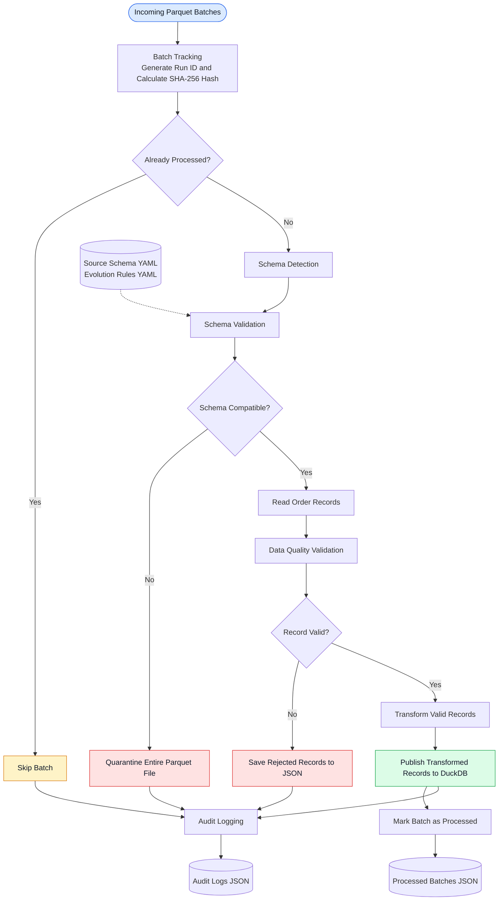

# SchemaGuard – System Architecture

## 1. Architecture Overview

SchemaGuard is a locally executable data engineering pipeline designed to process multiple Parquet batches, detect schema changes, validate incoming records, and publish accepted data into DuckDB.

The architecture follows a modular approach. Each major responsibility is handled by a separate Python module, making the pipeline easier to maintain, test, and extend.

The pipeline supports:

- Parquet data ingestion.
- Schema drift detection.
- Configurable schema evolution.
- Record-level data quality validation.
- Duplicate and foreign-key validation.
- Quarantine management.
- Data transformation.
- Target database publishing.
- Audit logging and batch tracking.

## 2. System Architecture Diagram

The following diagram illustrates the end-to-end processing flow of SchemaGuard.

## 3. Architecture Components

### 3.1 Input Data Layer

Incoming data is supplied as Parquet files.

The project contains two primary source entities:

**Customers**
- Stores customer master information.
- Contains customer identifiers and customer details.
- Used to validate order references.

**Orders**
- Stores customer order transactions.
- Each order is identified by a unique order ID.
- References a customer through `customer_id`.

Input files are organized under:

- `data/input/customers/`
- `data/input/orders/`

### 3.2 Configuration Layer

The configuration layer maintains expected schemas and permitted schema changes.

**File: `config/source_schema.yaml`**

Defines:
- Expected columns.
- Data types.
- Nullability.
- Primary keys.
- Foreign-key relationships.
- Business constraints.

**File: `config/evolution_rules.yaml`**

Defines:
- Approved nullable column additions.
- Approved safe integer type widening.
- Rejected incompatible schema changes.
- Unapproved schema changes.

These configuration files allow schema rules to be maintained separately from the pipeline implementation.

### 3.3 Batch Tracking

**Implementation:** `src/batch_tracker.py`

The batch tracker manages batch identification and processing history.

Responsibilities:

- Generate a unique run ID.
- Calculate SHA-256 file hashes.
- Identify previously processed batches.
- Record processed batch information.
- Prevent unintended reprocessing of identical file contents.

If the same file content has already been processed, the pipeline skips it.

### 3.4 Schema Detection

**Implementation:** `src/schema_detector.py`

The schema detector compares the incoming Parquet schema with the expected source schema.

It identifies:

- Added columns.
- Missing columns.
- Changed data types.

The detected differences are passed to the schema validation module.

### 3.5 Schema Validation

**Implementation:** `src/schema_validator.py`

The schema validator evaluates detected changes against the configured evolution rules.

Examples of approved changes:

- Addition of explicitly approved nullable columns.
- Safe integer type widening where supported.

Examples of rejected changes:

- Missing required columns.
- Incompatible data type changes.
- Unapproved columns.
- Required columns added without defaults.

If a schema change is rejected, the entire Parquet batch is moved into quarantine.

### 3.6 Data Ingestion

**Implementation:** `src/ingestion.py`

The ingestion module reads incoming Parquet files using PyArrow.

Responsibilities:

- Check whether the input file exists.
- Check for zero-byte files.
- Read Parquet records.
- Convert records into Python dictionaries for downstream processing.

### 3.7 Data Quality Validation

**Implementation:** `src/data_quality.py`

After schema validation, individual order records undergo data quality checks.

The module validates:

- Required order fields.
- Order identifiers.
- Duplicate order IDs.
- Order amounts.
- Allowed order statuses.
- Discount values.
- Customer references.

Valid and invalid records are separated.

### 3.8 Quarantine Management

**Implementation:** `src/quarantine.py`

SchemaGuard maintains two rejection paths.

**Schema-level quarantine**

Entire Parquet files with incompatible or unapproved schema changes are moved into:

`data/quarantine/`

**Record-level quarantine**

Individual invalid order records are saved in:

`data/quarantine/rejected_records/rejected_orders.json`

Rejected records retain:

- Source filename.
- Original record data.
- Validation errors.
- Quarantine timestamp.

This supports traceability and investigation of data quality issues.

### 3.9 Data Transformation

**Implementation:** `transform_orders()` in `src/pipeline.py`

Valid order records undergo deterministic transformation before publishing.

The pipeline calculates:

`amount_after_discount = amount × (1 - discount / 100)`

If the discount is missing, it is treated as zero.

The calculated value is rounded to two decimal places.

### 3.10 Target Publishing

**Implementation:** `src/loader.py`

Validated and transformed records are published into DuckDB.

DuckDB provides a local analytical storage layer for querying processed order data.

The target database is maintained in the project database directory.

### 3.11 Audit Logging

**Implementation:** `src/pipeline.py`

Each pipeline execution generates an audit record.

The audit information includes:

- Run ID.
- Source filename.
- Start timestamp.
- End timestamp.
- Records received.
- Records accepted.
- Records rejected.
- Processing status.
- Failure reason, where applicable.

Audit records are stored in:

`database/audit_logs.json`

Processed batch information is maintained in:

`database/processed_batches.json`

## 4. End-to-End Processing Workflow

The pipeline follows these steps:

1. Incoming order batches are placed in the input directory.
2. The batch tracker generates a run ID and calculates the file hash.
3. Previously processed batches are identified and skipped.
4. The incoming Parquet schema is compared with the expected schema.
5. The schema validator checks whether detected changes are permitted.
6. Incompatible schema batches are moved into quarantine.
7. Compatible batches are read for record-level validation.
8. Individual records are checked against business rules.
9. Invalid records are saved separately with rejection reasons.
10. Valid records undergo transformation.
11. Transformed records are published into DuckDB.
12. Batch tracking and audit information are updated.

## 5. Storage Architecture

| Location | Purpose |
|---|---|
| `config/` | Expected schemas and evolution rules |
| `data/input/customers/` | Incoming customer Parquet files |
| `data/input/orders/` | Incoming order Parquet batches |
| `data/quarantine/` | Schema-rejected Parquet batches |
| `data/quarantine/rejected_records/` | Invalid individual order records |
| `database/audit_logs.json` | Pipeline execution history |
| `database/processed_batches.json` | Processed batch tracking |
| `database/schemaguard.duckdb` | Target analytical database |

## 6. Architecture Design Principles

**Modularity:** Pipeline responsibilities are separated into individual Python modules.

**Configurability:** Expected schemas and evolution rules are maintained in YAML configuration files.

**Traceability:** Rejected records retain their source information and validation errors.

**Reproducibility:** Synthetic datasets are generated using a fixed random seed.

**Idempotency:** SHA-256 file hashes are used to identify previously processed batches.

**Maintainability:** The codebase is organized into source, configuration, scripts, and test directories.

## 7. Deployment Environment

SchemaGuard currently runs locally using:

- Python.
- PyArrow.
- DuckDB.
- YAML configuration files.
- Local Parquet datasets.

No external cloud infrastructure or credentials are required.

This local implementation provides a reproducible environment for demonstrating schema drift detection, schema evolution, data quality validation, quarantine management, and analytical data publishing.

## 8. Current Architecture Limitations

- The solution uses local file storage and DuckDB rather than distributed cloud infrastructure.
- The performance benchmark currently measures Parquet reading rather than complete end-to-end processing.
- Some physical Parquet data types cannot reliably distinguish logical integer and bigint types.
- Full restart recovery and historical backfill have not been completely validated.
- Target database reconciliation and additional integration testing remain areas for improvement.